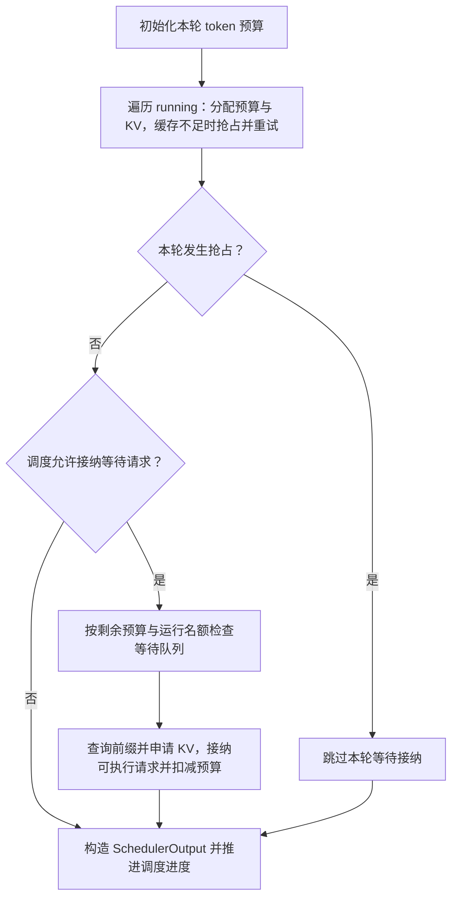

# Scheduler Overview

**Scheduler 将请求剩余的计算需求与本轮预算、运行名额和 KV Cache 条件对齐，形成执行计划，再根据结果推进请求。**

本文沿本地源码的普通文本、decoder-only、`n=1`、单核心生成路径阅读。先用基础 `Scheduler` 和每轮结果返回后再开始下一轮的顺序建立认识，最后再看异步调度。读完应能手工解释：谁入选、算多少、谁等待、谁被抢占，以及下一轮为什么还能继续。

## 1. 接上上一章：进入 schedule 内部

第二章已经建立核心闭环；本章展开其中的选择与状态更新：

```text
EngineCore.add_request
    → Scheduler.add_request：登记 Request，放入等待队列

EngineCore.step
    → Scheduler.schedule
        → 先为 running 中的请求安排计算
        → 条件允许时，从等待队列接纳请求
        → 构造 SchedulerOutput，推进调度侧进度
    → Executor.execute_model / sample_tokens
    → Scheduler.update_from_output
        → 追加有效输出、判停、清理，构造核心增量
    → 未完成的请求参与后续轮次
```

Scheduler 决定本轮参与计算的请求与 token 数；KVCacheManager 提供缓存命中与分配结果；Executor 和 Worker / Model Runner 落实模型执行。先分清这三个边界，再追踪它们的交接。

## 2. 组件与持久状态：请求保存在哪里

```text
Scheduler
├─ scheduler_config：预算、运行数量上限、策略与分块配置
├─ requests：request_id → Request，按 ID 查找持久状态
├─ waiting：普通等待请求与等待恢复的 PREEMPTED 请求
├─ skipped_waiting：暂时因依赖或约束跳过的等待请求
├─ running：已接纳的运行请求列表
└─ kv_cache_manager：查询可复用 KV，分配与释放缓存块引用
```

请求表和队列引用同一个 Request：表支持结果返回后的查找，队列与列表组织调度。调度时还会检查 `skipped_waiting` 中请求的 grammar、远端 KV 等依赖是否就绪；它与 `waiting` 之间的选择由 `_select_waiting_queue_for_scheduling()` 组织。

| 状态或集合 | 应怎样理解 |
| --- | --- |
| WAITING | 等待首次接纳的普通请求 |
| RUNNING / running | 已接纳并保留运行状态；本轮仍可能因预算或其他条件没有入选 |
| PREEMPTED | 从运行集合退出，等待重新接纳；仍是未完成请求 |
| WAITING_FOR_* | 等待额外依赖或后续流式输入，主线之外按需追踪 |
| FINISHED_* | 请求完成、取消或出错，进入相应清理路线 |

**RUNNING 不等于 Decode。** 长 Prompt 被分块后，请求已经在 running 中，却仍需要多轮 Prefill；生命周期状态和当前计算阶段要分别理解。

## 3. 统一进度模型：本轮还需要算什么

`schedule()` 用 token 进度统一描述工作。源码中仍有 `is_prefill_chunk` 等阶段判断，但普通 Prefill、Chunked Prefill 和 Decode 共用这套计算需求与预算框架。

| 字段 | 含义 |
| --- | --- |
| Request.num_prompt_tokens | 输入 Prompt 的 token 数 |
| Request.num_tokens | 已知的 Prompt 与正式输出 token 总数 |
| Request.num_tokens_with_spec | num_tokens 加上当前推测 token 的数量 |
| Request.num_computed_tokens | 调度侧已推进的 token 位置，可能包含在途工作 |
| Request.num_output_placeholders | 异步调度为尚未返回的输出预留的数量 |
| SchedulerOutput.num_scheduled_tokens | request_id 到本轮计算 token 数的映射 |

先忽略推测 token、异步占位与缓存命中，运行请求的需求可以写成下面的**公式示意**：

```text
待计算数量 = num_tokens - num_computed_tokens
本轮计算量 = 待计算数量，再受剩余预算、长度及缓存条件限制

完整 RUNNING 路线的初始需求：
num_tokens_with_spec + num_output_placeholders - num_computed_tokens
```

例如 Prompt 有 6 个 token：

| 时刻 | num_tokens | num_computed_tokens | 下一轮待计算数量 |
| --- | ---: | ---: | ---: |
| 刚提交 | 6 | 0 | 6，尚未处理 Prompt |
| 完成首个 2-token 分块 | 6 | 2 | 4，继续 Prefill |
| Prompt 全部算完，并生成第 1 个输出 token | 7 | 6 | 1，计算刚生成的 token |
| 再计算 1 个位置，并生成第 2 个输出 token | 8 | 7 | 1；若已满足结束条件，则直接结束 |

**计算量与生成量不同。** 完成 Prompt 的那一轮通常产生第一个输出 token；中间 Prefill 分块不产生正式输出。普通 Decode 通常计算一个已知 token 的位置，再采样下一个 token。

## 4. 一轮选择：先运行请求，再接纳等待请求

下面是省略扩展分支的路线示意：



### 4.1 运行请求共享 token 预算

Scheduler 按 `running` 列表顺序访问请求，计算进度差，应用分块阈值、剩余预算与最大长度限制，再向 KVCacheManager 申请所需缓存。成功后记录本轮计算量并扣减预算。

本地源码用 `max_num_scheduled_tokens` 初始化预算；配置未单独指定时，回退到 `max_num_batched_tokens`。因此阅读这份源码时，要沿实际字段追踪，不能始终将两个配置视为完全相同。

| 约束 | 限制什么 |
| --- | --- |
| max_num_scheduled_tokens | 一次 schedule 可安排的 token 总数；默认回退到 max_num_batched_tokens |
| max_num_seqs | 可接纳的运行请求数量，映射为 max_num_running_reqs；流式输入另有名额统计 |
| max_model_len | 单请求的总长度边界，生成路径还需为采样位置留出空间 |
| long_prefill_token_threshold | 正值时，在需求超过阈值的相应分支限制本轮计算量；0 关闭该上限 |
| KVCacheManager.allocate_slots 的结果 | 需要的 KV 存储是否能够安排；有 token 预算仍可能分配失败 |

运行请求本轮需求为 0 时可以跳过继续访问后面的请求。预算耗尽时，本轮停止继续分配；未入选的请求仍可能保留 RUNNING 状态。

### 4.2 等待请求需要先通过接纳条件

运行请求安排之后，若本轮没有因缓存不足抢占请求、调度未暂停，才进入等待路线。循环还需要剩余 token 预算与运行名额。

```text
选择 waiting / skipped_waiting 的队首
    → 检查依赖是否就绪，不满足的请求暂时跳过
    → 查询可复用前缀，确定起始 num_computed_tokens
    → 计算尚需执行的 token，按剩余预算与阈值裁剪
    → 申请 KV 块；成功后移出等待队列，加入 running
    → 标记 RUNNING，登记为新接纳或恢复的请求
```

启用 `enable_chunked_prefill` 时，长 Prompt 可以只使用本轮剩余预算，未算完的部分在后续 running 路线继续。关闭时，如果该请求需要的计算量超过剩余预算，等待路线会停止本轮接纳。

前缀命中提供已经可复用的计算进度，减少本轮需算的 token；命中的 KV 仍占用缓存资源。缓存命中与 Prompt 分块也可以同时发生，具体匹配与块管理进入下一章。

### 4.3 FCFS 与 Priority 怎样影响顺序

| 策略 | 等待队列 | 缓存不足时的抢占选择 |
| --- | --- | --- |
| fcfs | 普通入队按先来先服务；被抢占请求会放回 waiting 前端 | 从 running 尾部选择请求 |
| priority | 较小 priority 值优先，同优先级按较早 arrival_time；队列比较还提供进一步的平局规则 | 按 `(priority, arrival_time)` 取最大者，即优先级较低、同级较晚到达者 |

策略主要作用于等待顺序和抢占选择；运行请求仍先按列表处理。某些分支会跳过受阻请求，也有分配失败后直接停止的分支，因此不能把整个 schedule 理解成一条严格 FCFS 队列。Priority 也不意味着新到的高优先级请求一定立即顶替运行请求。

## 5. 执行交接：计划里有什么，进度何时变化

`SchedulerOutput` 将本轮选择交给执行侧：

| 数据 | 执行侧为什么需要 |
| --- | --- |
| scheduled_new_reqs / NewRequestData | 建立请求状态，取得输入、参数、缓存块与执行起点等信息 |
| scheduled_cached_reqs / CachedRequestData | 更新执行侧已经保存的请求状态，减少重复传输 |
| num_scheduled_tokens、total_num_scheduled_tokens | 知道每条请求与整个批次需要计算多少 token |
| 请求数据中的 block_ids / new_block_ids | 将请求的逻辑位置对应到已安排的 KV 块 |
| finished_req_ids | 通知执行侧清理此前已结束请求的缓存状态 |
| scheduled_spec_decode_tokens、scheduled_encoder_inputs 等 | 支持推测解码、多模态等附加工作 |

这里的「cached request」指执行侧已经保存请求状态，不能据此判断该请求命中了 Prefix Cache。恢复请求如何包装还取决于 Model Runner 版本：本地 V2 路线把恢复请求并入 `scheduled_new_reqs`，另一条路线通过 cached 数据传递恢复信息。

`schedule()` 先用原始执行起点构造计划，再调用 `_update_after_schedule()`：增加 Request 的 `num_computed_tokens` 与 `num_in_flight_tokens`，并更新是否仍处于 Prefill 分块的标记。因此 **schedule 已经改变请求状态**，并非只返回一份计划。

进度提前推进让后续调度能够继续安排未覆盖的位置。它表示调度侧已经安排到哪里；执行结果回来前，其中可能还有在途计算，推测 token 被拒绝时还需要修正。

## 6. 用三条请求走完四轮

设每轮 token 预算为 **4**，`max_num_seqs=2`，启用 Chunked Prefill，`long_prefill_token_threshold=0`。KV 容量充足、长度限制不触发，无前缀命中、推测解码、异步占位或提前停止。

- B：2 个 Prompt token，最多生成 2 个 token，先于 A 入队。
- A：6 个 Prompt token，最多生成 2 个 token。
- C：2 个 Prompt token，最多生成 2 个 token，在第 3 轮开始前到达。

每轮执行结果处理完成后，再开始下一轮：

| 轮次 | 本轮安排的计算 | 执行后新增输出 | 请求与批次变化 |
| --- | --- | --- | --- |
| 1 | B 的 2 个 Prompt token；A 的前 2 个 Prompt token，总计 4 | B：第 1 个；A：无 | B、A 都进入 running；A 尚在 Prefill |
| 2 | B 的 1 个 Decode token；A 的后续 3 个 Prompt token，总计 4 | B：第 2 个；A：无 | B 达到上限退出；A 已处理 5/6 个 Prompt token |
| 3 | A 最后 1 个 Prompt token；新接纳 C 的 2 个 Prompt token，总计 3 | A、C：各第 1 个 | A 完成 Prefill；C 使用空出的运行名额加入 |
| 4 | A、C 各 1 个 Decode token，总计 2 | A、C：各第 2 个 | 两条请求都达到上限退出 |

第 2 轮中，B 的 Decode 与 A 的 Prefill 分块共享预算；第 3 轮中，C 在 A 尚未结束时加入。这分别体现 Chunked Prefill 与 Continuous Batching：前者改变单请求每轮计算量，后者允许批次成员在轮次之间变化。

A 的 `num_computed_tokens` 依次推进到 2、5、6、7。第 3 轮追加输出后，`num_tokens` 从 6 变成 7，于是第 4 轮又出现 1 个位置的需求。若达到输出上限，请求结束，不再继续追赶新追加的最后一个 token。

## 7. 缓存压力：抢占之后怎样恢复

运行请求的 `allocate_slots()` 返回 `None` 时，Scheduler 选择运行请求抢占，再尝试分配。如果被抢占者正是当前请求，当前请求本轮也无法继续安排。

```text
RUNNING
    → 从 running 移除，必要时撤回本轮已登记的计划与预算
    → _preempt_request：释放缓存块引用，清理相关状态
    → num_computed_tokens 归零，标记 PREEMPTED
    → 放回 waiting，保留输入与正式输出 token 历史
    → 后续轮次重新查询前缀、申请块、接纳为 RUNNING
```

抢占释放的是执行资源；请求本身尚未结束。恢复时根据保留的完整 token 历史重新建立计算进度，可复用的前缀减少重算；不能复用的 KV 需要重新计算。恢复需求因此使用 `request.num_tokens`，其中可能已经包含输出 token。

本地实现中，运行路线本轮发生抢占后不会继续接纳等待请求。等待路线申请失败时则停止继续接纳，已有运行请求可以按已安排的计划执行。两处失败路径的处理方式不同。

接纳还可能受 `scheduler_reserve_full_isl` 与 `watermark` 影响：前者检查当前已知整段序列的 KV 需求能否容纳，后者在相应接纳条件下保留空闲块余量。整段检查是接纳门槛，并不意味着本轮必须计算或立即分配整个 Prompt，也没有预先保留所有未来输出的空间。

抢占不要求把 KV 搬到 CPU；这里先沿释放引用、等待恢复与重算阅读。在途执行、远端传输与缓存复用下的实际回收时机，进入 [KV Cache Management](../04-KV-Cache-Management/) 深入。

## 8. 结果更新：让下一轮有新的计算需求

执行侧返回 `ModelRunnerOutput`，Engine Core 将它和原来的 SchedulerOutput 一起传入 `update_from_output()`：

```text
按本轮计划遍历 request_id
    → 扣减对应在途计数，检查请求是否仍有效
    → 通过 req_id_to_index 找到模型返回的 token
    → 需要时修正推测 token 被拒绝后的进度
    → _update_request_with_output：逐个追加有效 token，调用 check_stop
    → 未结束：保留 Request，下一轮根据新进度继续安排
    → 已结束：更新状态、移出队列、释放资源引用
    → 构造 EngineCoreOutput，按客户端组织为 EngineCoreOutputs
```

追加 token 会同时增加正式输出序列与完整 token 历史，使 `num_tokens` 增长。普通 Decode 下一轮通常又有一个新位置需要计算。

`check_stop()` 负责 EOS、停止 token、长度及已配置的重复检测等条件；入口 OutputProcessor 继续负责文本还原与停止字符串等处理。中间 Prompt 分块预期返回空 token 列表，核心不为它交付部分 Prefill 的用户输出。

外部取消通过 `finish_requests()` 进入清理。若模型执行期间已经取消请求，更新结果时会跳过不存在或已结束的请求；完成 ID 还会通过后续 SchedulerOutput 通知执行侧清理其保存的状态。

## 9. 进入异步与扩展分支之前

| 扩展 | 相对基础主线增加什么 |
| --- | --- |
| AsyncScheduler | 在已安排生成的位置上增加输出占位，结果回来后扣减；允许后续计划在真实 token 尚未返回调度侧时继续形成 |
| 推测解码 | 需求还包含 draft token；本轮可返回多个有效 token，被拒绝部分需要回退进度 |
| 多模态与结构化输出 | encoder 计算与缓存预算、grammar 就绪状态等额外约束 |
| 远端 KV、流式输入与分布式执行 | 额外等待状态、传输完成检查、预留资源及轮次协调 |

`SchedulerConfig.get_scheduler_cls()` 根据配置选择基础 Scheduler、AsyncScheduler 或自定义实现。本文先读基础类是为了看清顺序，实际类型需以运行配置为准。

AsyncScheduler 继承基础算法，重点扩展 `_update_after_schedule()` 与 `_update_request_with_output()`。阅读时同时跟踪 `num_computed_tokens`、`num_in_flight_tokens` 和 `num_output_placeholders`：它们分别描述调度进度、尚未处理结果的计算量和待返回输出占位。抢占时还需处理原先在途结果，避免它们错误修改已经重置的进度。

第二章的 batch queue 负责保存多批在途执行及其计划、Future，AsyncScheduler 负责请求进度与占位；同进程 / 多进程则描述通信与驱动方式。这几个维度需要分别追踪。

## 10. 回到源码的阅读路线与自测

下表路径相对于 `04-vLLM-Source/vllm/`；行号对应本地快照，用于定位阅读起点。

| 顺序 | 文件与起点 | 重点问题 |
| --- | --- | --- |
| 01 | [scheduler.py](../../vllm/vllm/v1/core/sched/scheduler.py) · Scheduler.__init__（L70）；[request.py](../../vllm/vllm/v1/request.py) · Request（L59）；[配置](../../vllm/vllm/config/scheduler.py) · SchedulerConfig（L26） | 调度器拥有哪些对象？配置怎样变成实际约束？ |
| 02 | scheduler.py · schedule（L439），先读 RUNNING 循环（L483 起） | 如何算进度差、裁剪计算量、申请缓存并扣减预算？ |
| 03 | scheduler.py · WAITING 路线（L683 起）、_select_waiting_queue_for_scheduling（L2064）；[request_queue.py](../../vllm/vllm/v1/core/sched/request_queue.py) | 新请求何时接纳？何时跳过，何时停止？ |
| 04 | scheduler.py · _preempt_request（L1274）；[kv_cache_manager.py](../../vllm/vllm/v1/core/kv_cache_manager.py) · get_computed_blocks（L229）、allocate_slots（L344） | 命中如何变成进度？分配失败如何触发抢占或等待？ |
| 05 | [output.py](../../vllm/vllm/v1/core/sched/output.py) · SchedulerOutput（L193）；scheduler.py · _update_after_schedule（L1317）、update_from_output（L1670）、_update_request_with_output（L2094）、finish_requests（L2237）；[utils.py](../../vllm/vllm/v1/core/sched/utils.py) · check_stop | 计划保存什么？哪些状态在执行前推进，哪些在结果返回后更新？ |
| 06 | [async_scheduler.py](../../vllm/vllm/v1/core/sched/async_scheduler.py) · AsyncScheduler（L12）；配置 · get_scheduler_cls（L170） | 在途计算与输出占位怎样衔接？实际选择了哪个调度器？ |

回看时尝试回答：

- Prompt 尚未计算完，为什么请求已经是 RUNNING？
- 本轮 token 预算还有余量，为什么新请求仍可能进不来？
- 将示例的预算从 4 改成 3，A 的 Prefill 与 C 的加入时机会怎样变化？
- 被抢占请求保留了输出 token，为什么仍可能需要重算？
- `scheduled_cached_reqs` 是否意味着命中了前缀缓存？
- 为什么 `num_computed_tokens` 增加后，还不能直接认定对应 GPU 计算已完成？

能将这些问题连接到同一轮的队列、预算、缓存和输出变化，就可以进入下一章，追踪调度依赖的 KV 块如何真正分配、复用与回收。

[返回章节目录](README.md) · [上一章：核心执行框架](../02-Engine-Core/Overview.md) · [下一章：KV Cache Management](../04-KV-Cache-Management/)
