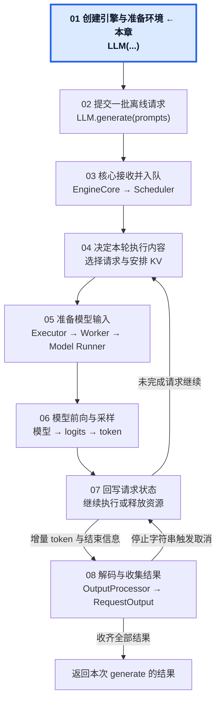
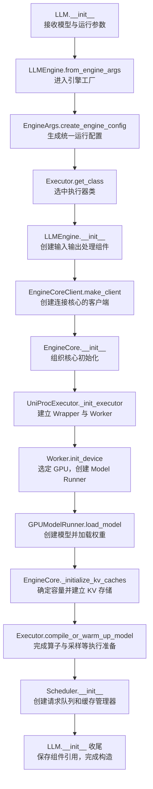

# 01 · 创建引擎与准备执行环境

本章完整跟踪一次 `LLM(...)` 构造：从用户提供模型和运行参数，到输入输出组件、核心、模型、KV Cache 与调度器都已准备好。第二章再提交一批离线请求。

## 1. 本章在推理引擎中的位置

## 2. 本章调用路线与用途

## 3. 七篇笔记与交接位置

| 顺序 | 笔记 | 进入时 → 结束时 |
| --- | --- | --- |
| 01 | [从 LLM 构造到运行配置](01-LLM-and-Engine-Configuration.md) | 用户参数 → VllmConfig 与选中的 Executor 类 |
| 02 | [建立入口与核心之间的连接](02-Entry-and-Core-Connection.md) | 构造 LLMEngine → 建立入口组件，通过客户端进入 EngineCore |
| 03 | [启动 Executor、Worker 与执行环境](03-Executor-Worker-and-Device.md) | 创建 Executor → Worker、GPU 与 Model Runner 就绪，进入模型加载 |
| 04 | [创建模型与加载权重](04-Model-Creation-and-Weight-Loading.md) | 调用 load_model → 模型结构、参数与加载后处理完成 |
| 05 | [确定 KV Cache 容量并初始化缓存](05-KV-Cache-Capacity-and-Initialization.md) | 模型已加载 → KV 需求、容量配置与实际 GPU 缓存建立 |
| 06 | [编译、预热与执行准备](06-Compilation-and-Warmup.md) | KV 缓存已建立 → 执行准备完成 |
| 07 | [创建调度器并完成初始化](07-Scheduler-and-Initialization-Completion.md) | 回到 EngineCore → Scheduler、执行方法及入口收尾完成，LLM 构造返回 |

## 4. 学习目标

读完本章应能：

- 从 LLM 构造追到配置、入口组件、核心、Worker 和模型的建立，再逐层返回。
- 分清用户入口、核心客户端、EngineCore、Executor、Worker 与 Model Runner。
- 解释模型配置读取、模型对象创建和权重填入的区别。
- 追踪 KV 需求如何与可用显存共同决定块数，以及实际存储如何交给模型层使用。
- 说明 profiling、编译、预热与 CUDA Graph 的作用和条件。
- 列出引擎长期复用的资源，以及尚待请求提交时创建的状态。

第 07 篇末尾有完整的就绪状态清单。确认模型、缓存、调度与入口都已准备好，再进入第二章跟踪整批请求。

[开始阅读第 01 篇](01-LLM-and-Engine-Configuration.md) · [总目录](../README.md) · [固定配置](../00-Reading-Setup.md) · [全局执行路线](../Overview.md) · [下一章：提交一批离线请求](../02-Offline-Request-Submission/README.md)
