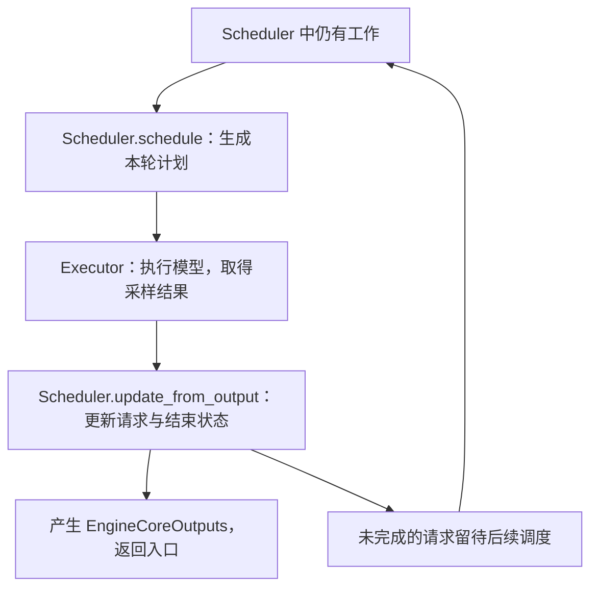

# Engine Core Overview

**EngineCore 把已经准备好的请求组织成一轮轮执行：选出本轮任务，交给执行器，处理执行结果，再让未完成的请求继续。**

先围绕普通文本生成建立整体认识。读完本文，应能解释「请求怎样进入核心」「一轮执行做什么」「结果怎样回到入口」，再进入具体模块。

## 1. 接上上一章：跨过客户端之后发生什么

```text
LLMEngine.add_request
    → EngineCoreClient.add_request
    → 核心接收 EngineCoreRequest
    → 转成 Request，交给 Scheduler 保存

核心一轮轮执行
    → 产生 EngineCoreOutputs
    → 客户端将输出交回 LLMEngine.step
    → OutputProcessor 解码并组织用户结果
```

这里出现了一个新的对象 `Request`：

| 对象 | 用来表达什么 |
| --- | --- |
| EngineCoreRequest | 入口提交过来的输入、参数和请求信息 |
| Request | 核心持续维护的请求，包含输入、已生成 token、执行进度与状态 |
| RequestState | 入口输出侧的状态，负责解码和组织用户结果；在上一章学习 |

同一个请求会同时有核心执行状态和入口输出状态。核心需要知道它下一轮还要计算什么，入口需要知道它已经生成了什么文本。

## 2. 组件框架：谁负责哪一段

```text
LLMEngine
└─ EngineCoreClient：提交、取输出、取消
       ↓↑
   EngineCore：组织核心执行
   ├─ Scheduler：维护请求，决定本轮执行计划，处理执行结果
   │   └─ KVCacheManager：管理调度使用的 KV 缓存块
   ├─ model_executor：Executor 的具体实现
   │   └─ Worker / Model Runner：准备模型输入，执行前向与采样
   └─ structured_output_manager：结构化输出约束，按需参与
```

| 组件 | 核心职责 |
| --- | --- |
| EngineCoreClient | 让入口能够联系核心，隔离进程与通信方式 |
| EngineCore | 把请求接收、调度、模型执行与结果更新连接起来 |
| Scheduler | 持有 Request，选择本轮计算内容，并根据返回结果更新状态 |
| KVCacheManager | 为调度提供可用缓存块，处理缓存分配、复用与释放 |
| Executor | 将本轮计划交给执行侧，取得 ModelRunnerOutput |
| Worker / Model Runner | 将计划落实为模型执行；具体实现见 [Model Execution](../05-Model-Execution/) |

核心初始化时，先创建 Executor，再通过 `_initialize_kv_caches()` 收集缓存需求、确定容量并初始化执行侧缓存，随后创建 Scheduler。这样调度器才能按照已经准备好的资源安排请求。

## 3. 接收请求：从提交数据变成持续执行的状态

```text
EngineCore.preprocess_add_request(EngineCoreRequest)
    → Request.from_engine_core_request(...)
    → 得到核心 Request
    ↓
EngineCore.add_request(Request)
    → Scheduler.add_request(Request)
    → 记录到请求表，进入等待队列
```

对于新的普通文本请求，初始状态是 `WAITING`。Scheduler 后续选中它并安排执行时，状态进入 `RUNNING`。`RUNNING` 表示请求已进入调度中的运行集合，一条请求通常会持续多轮。

Request 保存的关键信息包括：

| 信息 | 为什么需要 |
| --- | --- |
| request_id | 把调度、模型结果和入口输出对应起来，沿用内部 ID |
| prompt_token_ids、num_prompt_tokens | 知道输入内容与长度 |
| output_token_ids | 记录已经生成的 token，供后续执行与判停使用 |
| num_computed_tokens | 记录调度侧已经推进的 token 进度 |
| status、max_tokens | 知道当前阶段与生成长度限制 |

`num_computed_tokens` 在调度阶段就会推进，异步执行时可能包含尚在途的计算。这里先理解它用于协调执行进度，具体更新时机沿 [Step 与执行闭环](Core-Modules/03-Step-and-Execution-Loop.md) 和 Scheduler 实现追踪。

## 4. 一轮执行：本章最重要的路线

先沿没有启用 batch queue 的 `EngineCore.step()` 阅读：



这三段之间通过明确的数据结构交接：

| 阶段 | 输入 → 输出 | 实际解决的问题 |
| --- | --- | --- |
| 调度 | 请求状态与资源情况 → SchedulerOutput | 这一轮选哪些请求，各计算多少 token，使用哪些缓存块？ |
| 执行 | SchedulerOutput → ModelRunnerOutput | 按计划运行模型，并取得本轮生成的 token 等结果 |
| 更新 | SchedulerOutput + ModelRunnerOutput → 核心输出与更新后的状态 | token 属于谁，谁完成了，谁还要继续？ |

对应的关键调用如下；这是调用路线示意：

```text
EngineCore.step
    → Scheduler.schedule
    → Executor.execute_model
    → 等待执行结果；需要时调用 Executor.sample_tokens
    → 处理执行期间收到的取消请求
    → Scheduler.update_from_output
    → 返回按客户端组织的 EngineCoreOutputs，以及本轮执行标记
```

本地 `step()` 中，`execute_model(..., non_block=True)` 返回 Future。取得其结果后，如果结果为 `None`，会继续调用 `sample_tokens()` 得到模型输出。因此沿主线阅读时，要把模型执行与取得采样结果接完整。

`Scheduler.update_from_output()` 将新 token 加入对应 Request，检查结束条件，处理完成请求，并构造携带内部 ID 的 `EngineCoreOutput`。多条增量再装入 `EngineCoreOutputs` 返回入口。

调度同时会推进请求进度、安排缓存等状态；并非所有状态变化都等到执行结果返回后才发生。

## 5. 用两条请求走完三轮

假设请求 A 有 4 个输入 token，最多生成 2 个 token；请求 B 有 2 个输入 token，最多生成 3 个 token。两条请求都已提交、资源足够，输入可在首轮算完，没有前缀缓存命中、推测解码或提前停止。

下表的 token 用数量表示，与实际文本切分无关：

| 轮次 | 本轮安排的计算 | 执行返回后 | 后续状态 |
| --- | --- | --- | --- |
| 第 1 轮 | A 的 4 个输入 token + B 的 2 个输入 token | A、B 各得到第 1 个输出 token | 两条请求继续 |
| 第 2 轮 | A、B 各计算上轮生成的 1 个 token | A、B 各得到第 2 个输出 token | A 达到生成上限，B 继续 |
| 第 3 轮 | B 计算上轮生成的 1 个 token | B 得到第 3 个输出 token | B 达到生成上限 |

这里最需要分清：**本轮计算了多少 token，与本轮新生成多少 token，是两个数量。** 首轮 Prefill 可以计算多个输入位置，再生成第一个输出 token；普通 Decode 通常利用上一轮生成的 token，继续计算并产生下一个。

每轮的请求集合也可以变化。请求结束后退出，新的等待请求可以在后续调度中加入；具体如何选择、怎样共享预算，在 [Scheduler 章节](../03-Scheduler/) 学习。

## 6. 谁在反复调用核心

### 6.1 同进程：入口取输出时推进核心

```text
LLMEngine.step
    → InprocClient.get_output
        → EngineCore.step_fn()
        → EngineCore.post_step(...)
        → 返回核心输出
```

同进程路径下，`InprocClient.add_request()` 也直接调用核心的预处理与接收方法。可以先沿这条较短的路线看懂交接。

### 6.2 多进程：后台循环持续处理输入和执行

`EngineCoreProc` 继承 `EngineCore`，在核心执行能力外增加进程通信和后台循环。

```text
客户端发送 ADD
    → 核心输入线程接收 EngineCoreRequest
    → preprocess_add_request：构造 Request
    → 放入 input_queue

EngineCoreProc.run_busy_loop 反复执行
    → _process_input_queue：取消息，处理新增、取消等请求
    → _process_engine_step
        → step_fn()：调度、执行、更新
        → 核心输出放入 output_queue
        → post_step(...)

输出线程发送结果
    → 客户端接收
    → LLMEngine.step 继续入口侧输出处理
```

同进程由调用方取输出时推进，多进程由后台循环推进；两条路径都会进入核心的执行步骤。输入、输出线程让消息收发与核心计算协作运行。

`step_fn` 在初始化时选择：没有 batch queue 时指向 `step`，启用后指向 `step_with_batch_queue`。后者允许先安排更多批次，再收取在途批次的结果，一次调用可能没有可返回的输出。先掌握第 4 节的闭环，再展开这条分支。

## 7. 请求结束：退出执行并衔接入口清理

正常完成时，Scheduler 检查 EOS、停止 token、生成长度及总长度等条件，更新结束状态，移出相应队列并安排资源清理。结束信息随核心输出返回，入口 OutputProcessor 据此构造结果并清理 RequestState。

取消也会走到核心：

```text
用户取消，或入口检测到停止字符串
    → LLMEngine / 核心客户端发送取消
    → EngineCore.abort_requests
    → Scheduler.finish_requests(..., FINISHED_ABORTED)
    → 移出队列，清理请求并释放相应缓存引用
```

入口状态与核心执行资源各自需要清理。核心释放请求持有的 KV 引用后，缓存块是否保留供前缀复用，以及在途计算时何时可以安全回收，继续在 KV Cache 章节学习。

## 8. 回到源码的定位与阅读路线

下表的源码路径相对于 `04-vLLM-Source/vllm/`；链接可直接打开本地快照。

| 阅读站点 | 文件与类 | 重点函数或结构 |
| --- | --- | --- |
| [01 · 组件与初始化](Core-Modules/01-EngineCore-and-Initialization.md) | [vllm/v1/engine/core.py](../../vllm/vllm/v1/engine/core.py) · EngineCore | __init__、_initialize_kv_caches |
| [02 · 接收请求](Core-Modules/02-Request-and-Admission.md) | 同上 · EngineCore；[vllm/v1/request.py](../../vllm/vllm/v1/request.py) · Request | preprocess_add_request、add_request、from_engine_core_request、RequestStatus |
| [03 · 执行一轮](Core-Modules/03-Step-and-Execution-Loop.md) | core.py · EngineCore；[vllm/v1/core/sched/scheduler.py](../../vllm/vllm/v1/core/sched/scheduler.py) · Scheduler；[vllm/v1/executor/abstract.py](../../vllm/vllm/v1/executor/abstract.py) · Executor | step、schedule、execute_model、sample_tokens、update_from_output |
| 03 · 数据交接 | [vllm/v1/core/sched/output.py](../../vllm/vllm/v1/core/sched/output.py)；[vllm/v1/outputs.py](../../vllm/vllm/v1/outputs.py)；[vllm/v1/engine/__init__.py](../../vllm/vllm/v1/engine/__init__.py) | SchedulerOutput、ModelRunnerOutput、EngineCoreOutput / EngineCoreOutputs |
| [04 · 谁驱动执行](Core-Modules/04-Core-Client-and-Process-Loop.md) | [vllm/v1/engine/core_client.py](../../vllm/vllm/v1/engine/core_client.py) · InprocClient / SyncMPClient；core.py · EngineCoreProc | add_request、get_output、run_busy_loop、_process_input_queue、_process_engine_step |
| [05 · 完成与取消](Core-Modules/05-Completion-and-Abort.md) | [vllm/v1/core/sched/utils.py](../../vllm/vllm/v1/core/sched/utils.py) · 模块级函数；core.py · EngineCore；scheduler.py · Scheduler | check_stop、abort_requests、finish_requests、_free_request |

读具体实现时，沿上表 01 → 05 推进；第 03 站是本章中心。调度先读输入输出和调用位置，后续在 [03 · Scheduler](../03-Scheduler/) 深入选择策略，再进入 [04 · KV Cache Management](../04-KV-Cache-Management/) 与 [05 · Model Execution](../05-Model-Execution/)。

回看主线时，尝试自己解释：新请求保存在哪里？本轮计划由谁产生？结果回来后谁更新 Request？未完成的请求如何再次参与执行？能把这几个问题连接起来，就建立了核心执行框架。

[返回章节目录](README.md) · [开始阅读 Core 01](Core-Modules/01-EngineCore-and-Initialization.md) · [上一章：入口整体框架](../01-Inference-Entry/Overview.md) · [下一章：Scheduler](../03-Scheduler/)
