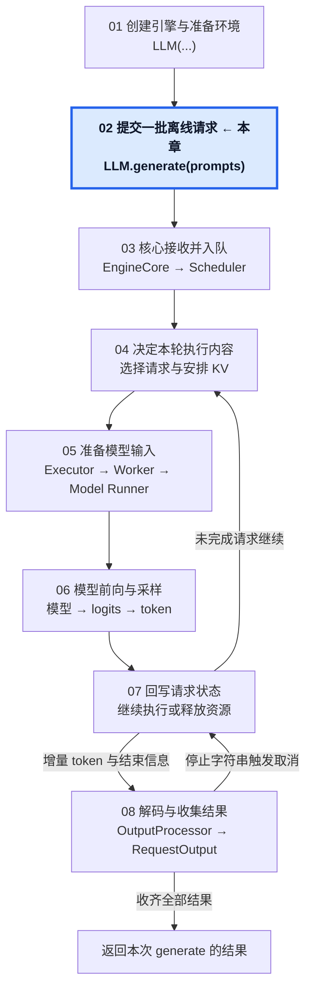
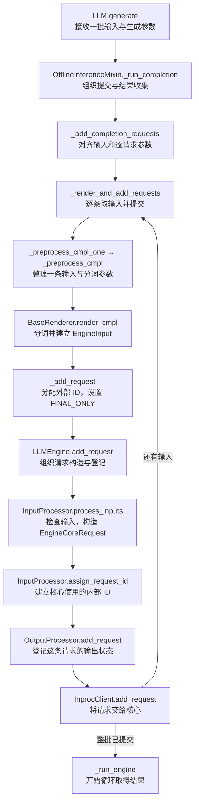

# 02 · 提交一批离线请求

从 LLM.generate(prompts) 到逐条提交核心请求。

## 1. 本章在推理引擎中的位置

## 2. 本章调用路线与用途

## 3. 章节范围

- 批量输入与生成参数对齐。
- Renderer、分词与统一输入表示。
- InputProcessor 校验与 EngineCoreRequest 构造。
- 请求 ID、输出状态注册与提交。

本章正文待迁移与整理。

[总目录](../README.md) · [固定配置](../00-Reading-Setup.md) · [全局执行路线](../Overview.md) · [上一章：创建引擎与准备执行环境](../01-Engine-Initialization/README.md) · [下一章：请求进入核心，等待执行](../03-Core-Request-Admission/README.md)
