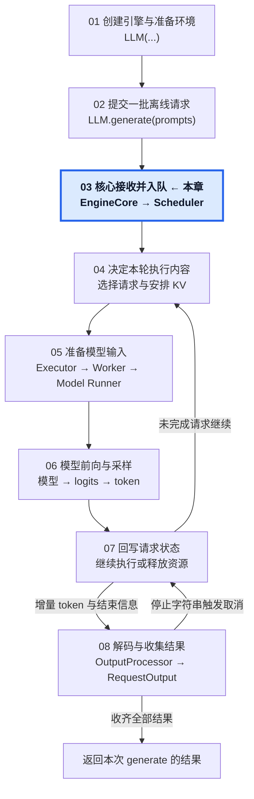
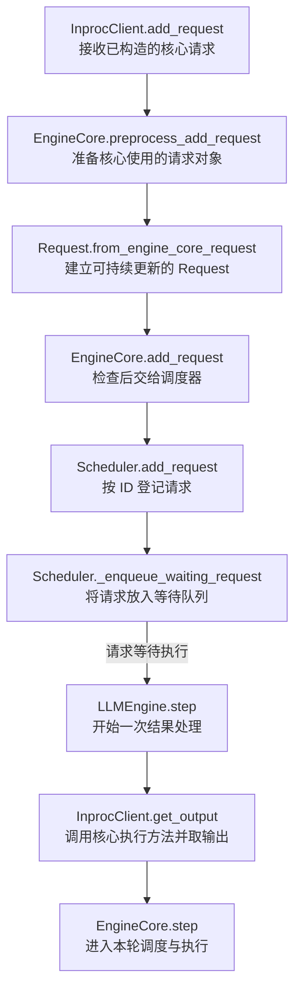

# 03 · 请求进入核心，等待执行

从核心接收请求到进入第一次调度。

## 1. 本章在推理引擎中的位置

## 2. 本章调用路线与用途

## 3. 章节范围

- 核心客户端与请求交接。
- EngineCoreRequest 转为核心 Request。
- 请求表、等待队列与初始状态。
- 核心执行循环的驱动与调度入口。

本章正文待迁移与整理。

[总目录](../README.md) · [固定配置](../00-Reading-Setup.md) · [全局执行路线](../Overview.md) · [上一章：提交一批离线请求](../02-Offline-Request-Submission/README.md) · [下一章：决定本轮执行哪些请求](../04-Step-Scheduling/README.md)
