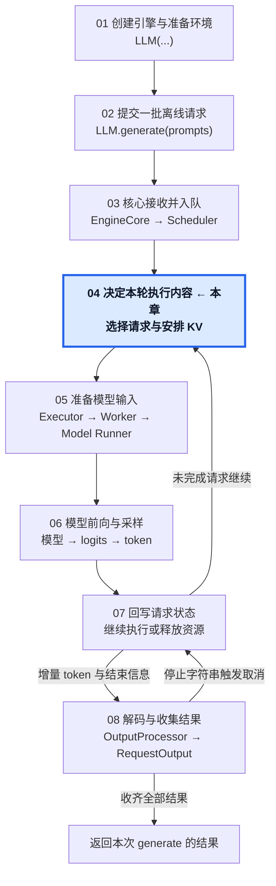
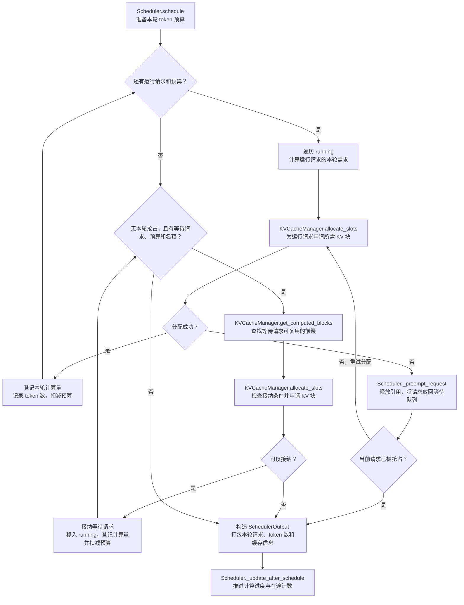

# 04 · 决定本轮执行哪些请求

从未完成请求与资源状态到本轮 SchedulerOutput。

## 1. 本章在推理引擎中的位置

## 2. 本章调用路线与用途

## 3. 章节范围

- token 进度、预算与运行请求选择。
- 等待请求接纳与连续批处理。
- Chunked Prefill、前缀缓存查询与 KV 块分配。
- 缓存压力、抢占与恢复。
- SchedulerOutput 构造与调度侧进度推进。

本章正文待迁移与整理。

[总目录](../README.md) · [固定配置](../00-Reading-Setup.md) · [全局执行路线](../Overview.md) · [上一章：请求进入核心，等待执行](../03-Core-Request-Admission/README.md) · [下一章：把执行计划变成模型输入](../05-Model-Input-Preparation/README.md)
