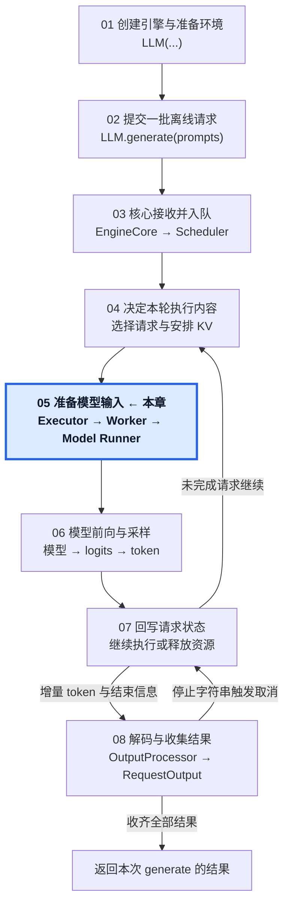
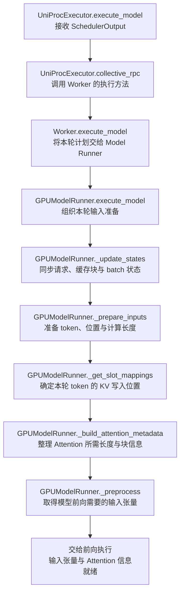

# 05 · 把执行计划变成模型输入

从 SchedulerOutput 到准备好本轮 GPU 计算输入。

## 1. 本章在推理引擎中的位置

## 2. 本章调用路线与用途

## 3. 章节范围

- Executor、Worker 与 Model Runner 的执行交接。
- 执行侧请求状态与 batch 组织。
- token 展平、位置与序列长度。
- block table、slot mapping 与 CPU / GPU 数据准备。

本章正文待迁移与整理。

[总目录](../README.md) · [固定配置](../00-Reading-Setup.md) · [全局执行路线](../Overview.md) · [上一章：决定本轮执行哪些请求](../04-Step-Scheduling/README.md) · [下一章：完成本轮前向与采样](../06-Forward-and-Sampling/README.md)
