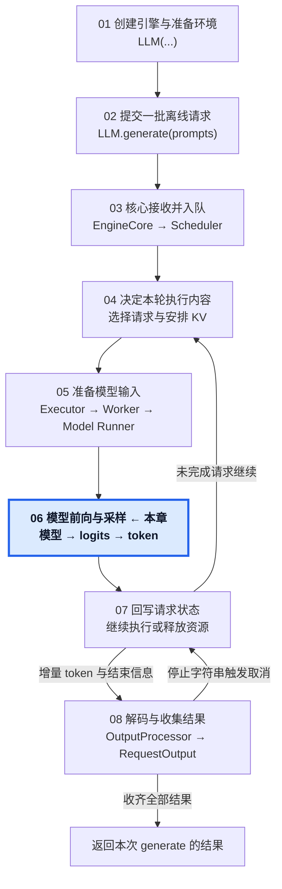
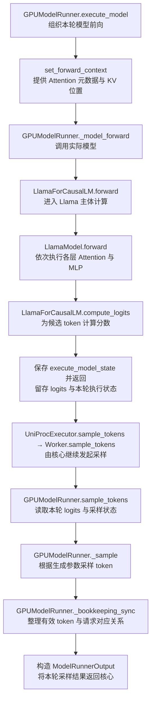

# 06 · 完成本轮前向与采样

从本轮模型输入到 ModelRunnerOutput。

## 1. 本章在推理引擎中的位置

## 2. 本章调用路线与用途

## 3. 章节范围

- 模型 forward 与必要的算子调用。
- Attention Backend 与 KV 读写。
- logits、采样与正式输出 token。
- Prefill 分块的输出行为与 ModelRunnerOutput。

本章正文待迁移与整理。

[总目录](../README.md) · [固定配置](../00-Reading-Setup.md) · [全局执行路线](../Overview.md) · [上一章：把执行计划变成模型输入](../05-Model-Input-Preparation/README.md) · [下一章：回写执行结果，推进下一轮](../07-Request-Update-and-Next-Step/README.md)
