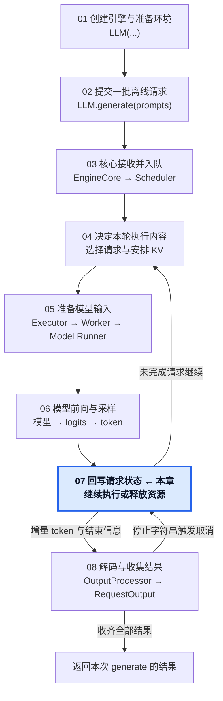
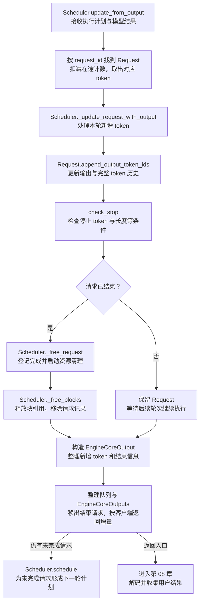

# 07 · 回写执行结果，推进下一轮

从模型执行结果到下一轮请求状态或核心收尾。

## 1. 本章在推理引擎中的位置

## 2. 本章调用路线与用途

## 3. 章节范围

- 按请求 ID 关联结果与追加有效 token。
- 计算进度、在途状态与停止条件。
- 完成请求退出与 KV 资源引用释放。
- 未完成请求进入下一轮调度。
- EngineCoreOutput 与核心增量返回。

本章正文待迁移与整理。

[总目录](../README.md) · [固定配置](../00-Reading-Setup.md) · [全局执行路线](../Overview.md) · [上一章：完成本轮前向与采样](../06-Forward-and-Sampling/README.md) · [下一章：将增量还原成文本，返回离线结果](../08-Output-and-Result-Collection/README.md)
