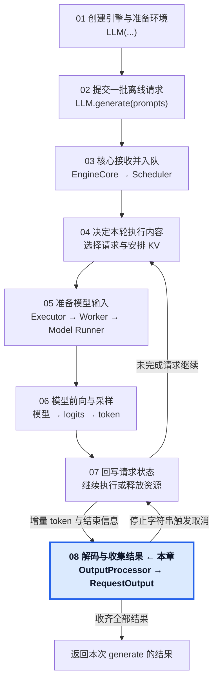
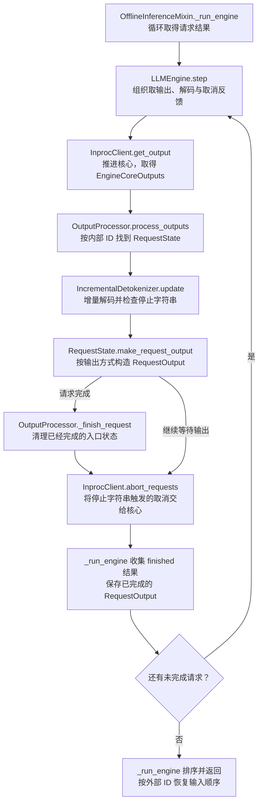

# 08 · 将增量还原成文本，返回离线结果

从核心增量输出到本次 generate 的最终结果。

## 1. 本章在推理引擎中的位置

## 2. 本章调用路线与用途

## 3. 章节范围

- 客户端取输出与 OutputProcessor 增量解码。
- 停止字符串、取消反馈与入口状态清理。
- FINAL_ONLY 与 RequestOutput 构造。
- 完成结果收集、排序与 generate 返回。

本章正文待迁移与整理。

[总目录](../README.md) · [固定配置](../00-Reading-Setup.md) · [全局执行路线](../Overview.md) · [上一章：回写执行结果，推进下一轮](../07-Request-Update-and-Next-Step/README.md)
