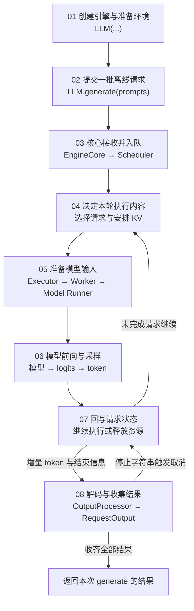

# 离线批量请求执行路线

本页用于定位八章之间的交接与循环。具体函数、数据结构和逐轮案例在各章正文中整理。

第 04～07 章对应反复进行的核心执行步骤；第 08 章持续处理返回的增量，直到本次离线调用收齐结果。批次成员随请求接纳与完成发生变化，连续批处理与 Prompt 分块在第 04 章展开。

## 贯穿案例安排

沿用同一批长短不同的请求，跟踪等待、接纳、Prefill、Decode、结束与资源释放。前缀复用、预算变化和缓存压力沿这批请求展开，具体参数与逐轮状态留待正文确定。

[返回总目录](README.md)

章节入口：[01](01-Engine-Initialization/README.md) · [02](02-Offline-Request-Submission/README.md) · [03](03-Core-Request-Admission/README.md) · [04](04-Step-Scheduling/README.md) · [05](05-Model-Input-Preparation/README.md) · [06](06-Forward-and-Sampling/README.md) · [07](07-Request-Update-and-Next-Step/README.md) · [08](08-Output-and-Result-Collection/README.md)
